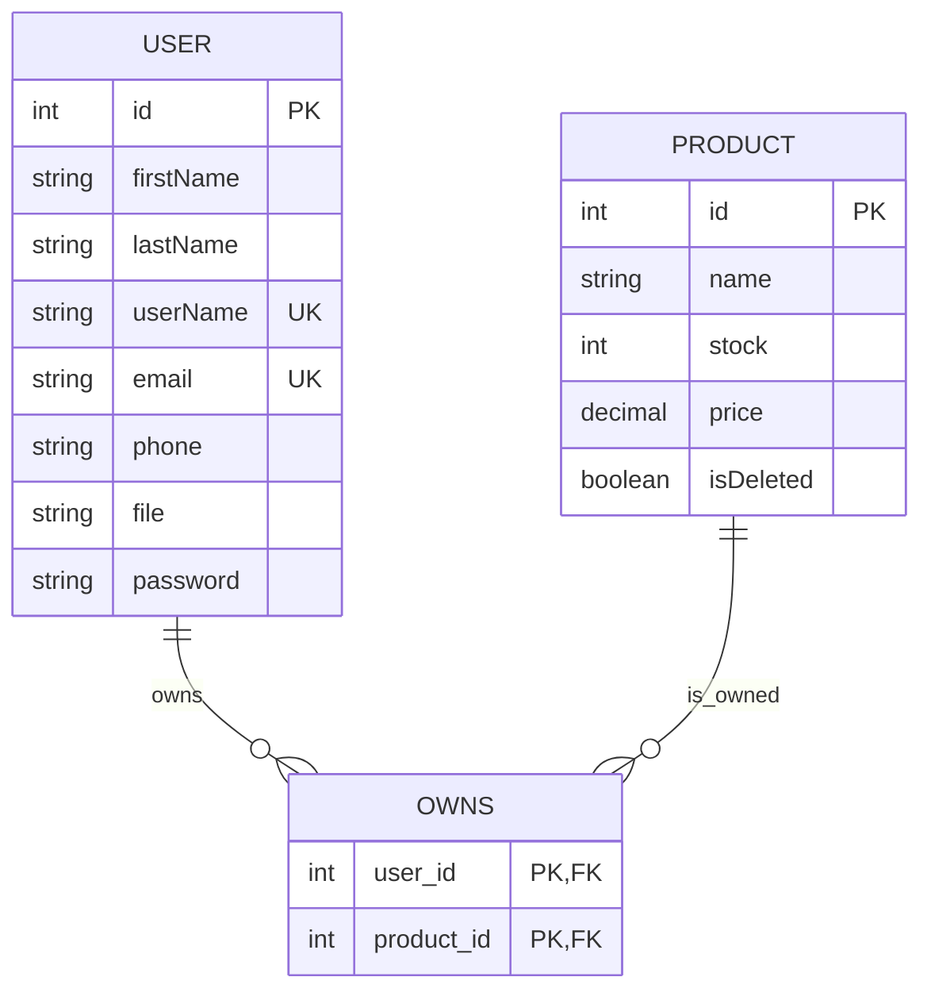

# Part 2 — Relational mapping of the supplied User–Owns–Product ERD

The supplied diagram maps to these relations (PK = primary key, FK = foreign key):

- **User**(`id` PK, `firstName`, `lastName`, `userName` UNIQUE, `email` UNIQUE, `phone`, `file`, `password`)
- **Product**(`id` PK, `name`, `stock`, `price`, `isDeleted`)
- **Owns**(`user_id` PK/FK → User.id, `product_id` PK/FK → Product.id)

`Owns` is the relationship table. A composite primary key `(user_id, product_id)` prevents duplicate ownership rows. The relationship is many-to-many in this mapping; if the instructor intended a one-to-many relationship, place `user_id` as an FK directly in Product instead.



## SQL mapping example
```sql
CREATE TABLE User (
  id INT AUTO_INCREMENT PRIMARY KEY,
  firstName VARCHAR(80) NOT NULL,
  lastName VARCHAR(80) NOT NULL,
  userName VARCHAR(80) NOT NULL UNIQUE,
  email VARCHAR(190) NOT NULL UNIQUE,
  phone VARCHAR(20),
  file VARCHAR(255),
  password VARCHAR(255) NOT NULL
);

CREATE TABLE Product (
  id INT AUTO_INCREMENT PRIMARY KEY,
  name VARCHAR(150) NOT NULL,
  stock INT NOT NULL DEFAULT 0,
  price DECIMAL(10,2) NOT NULL,
  isDeleted BOOLEAN NOT NULL DEFAULT FALSE
);

CREATE TABLE Owns (
  user_id INT NOT NULL,
  product_id INT NOT NULL,
  PRIMARY KEY (user_id, product_id),
  FOREIGN KEY (user_id) REFERENCES User(id),
  FOREIGN KEY (product_id) REFERENCES Product(id)
);
```
