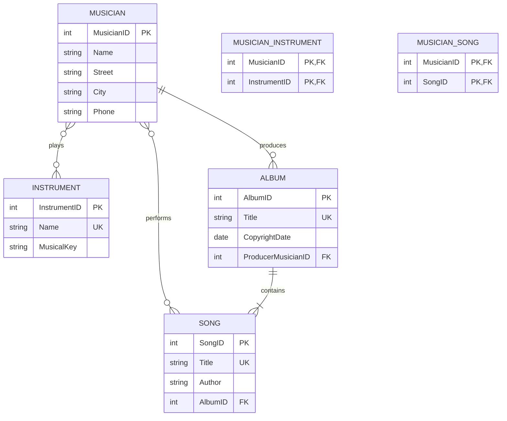

# Part 1 — Musicana ERD

## Assumptions and cardinalities
- A musician can play multiple instruments, and an instrument can be played by multiple musicians (M:N).
- A song belongs to zero or one album; an album contains one or more songs. `Song.AlbumID` can be nullable if unassigned songs are allowed.
- Every song is performed by one or more musicians; musicians may perform many songs (M:N).
- Each album has exactly one producing musician; a musician may produce zero or many albums.
- Instrument names, album titles, and song titles are unique as stated in the brief.
- `MUSICIAN_INSTRUMENT` and `MUSICIAN_SONG` are bridge tables for many-to-many relationships.
